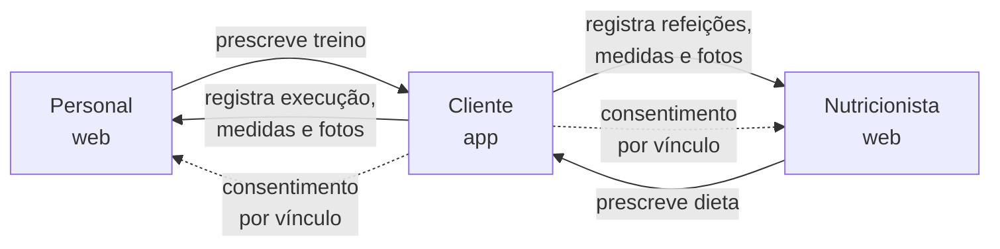
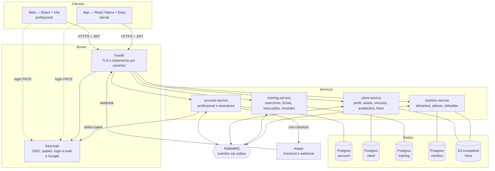
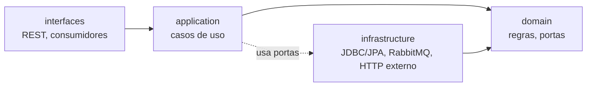
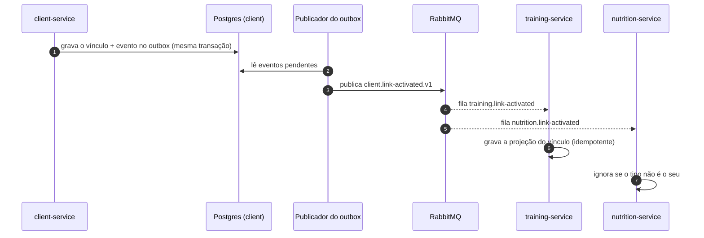
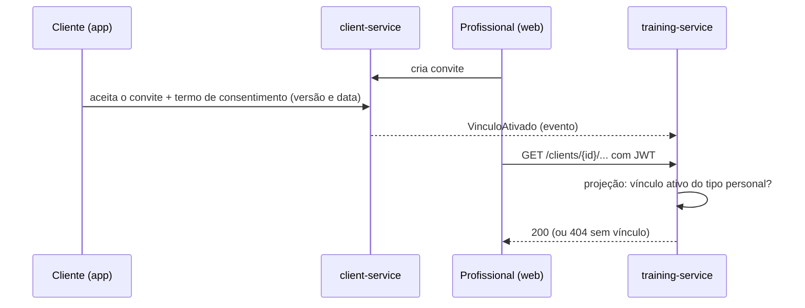
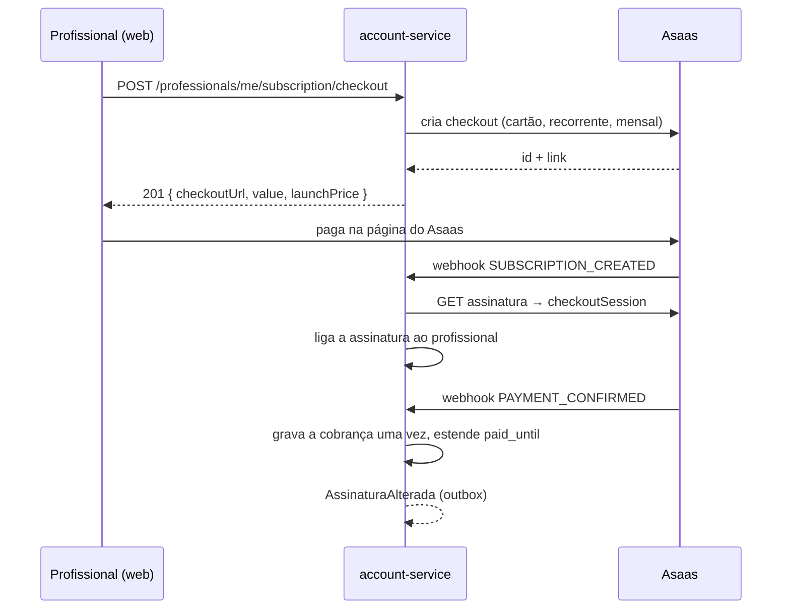
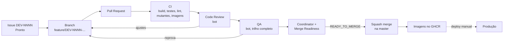
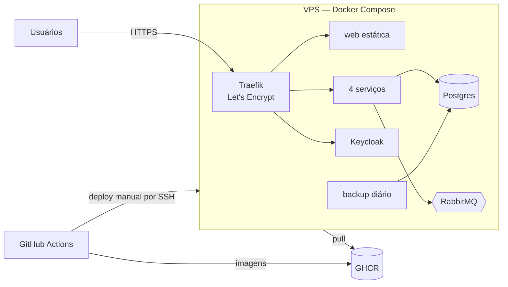

# FitHub

Plataforma SaaS que conecta personal trainers e nutricionistas aos seus clientes. O profissional prescreve treinos ou
dietas e acompanha a evolução; o cliente recebe as prescrições, registra o que fez e acompanha o próprio progresso,
sempre como dono dos próprios dados.

> **Status:** MVP em desenvolvimento. O produto ainda não está em produção.

- **Produto:** [PRD](docs/00-oficial/PRD.md)
- **Engenharia:** [ENGENHARIA](docs/00-oficial/ENGENHARIA.md)
- **Backlog:** [BACKLOG](docs/00-oficial/BACKLOG.md)
- **Estado atual:** [estado-atual](docs/00-oficial/estado-atual.md)
- **Decisões (ADRs):** [docs/00-oficial/adr](docs/00-oficial/adr/README.md)
- **Regras de trabalho:** [AGENTS.md](AGENTS.md)
- **Quadro:** [GitHub Projects — FitHub MVP](https://github.com/users/TitoStauffer/projects/1)

---

## Sumário

1. [Objetivo do sistema](#objetivo-do-sistema)
2. [Os três lados do produto](#os-três-lados-do-produto)
3. [Princípios](#princípios)
4. [Arquitetura](#arquitetura)
5. [Serviços e responsabilidades](#serviços-e-responsabilidades)
6. [Comunicação por eventos](#comunicação-por-eventos)
7. [Identidade e acesso](#identidade-e-acesso)
8. [Integrações externas](#integrações-externas)
9. [Stack](#stack)
10. [Decisões de arquitetura](#decisões-de-arquitetura)
11. [Estrutura do repositório](#estrutura-do-repositório)
12. [Como rodar localmente](#como-rodar-localmente)
13. [Qualidade e testes](#qualidade-e-testes)
14. [Fluxo de entrega](#fluxo-de-entrega)
15. [Observabilidade](#observabilidade)
16. [Produção](#produção)
17. [Privacidade e LGPD](#privacidade-e-lgpd)

---

## Objetivo do sistema

Hoje, personal trainers e nutricionistas autônomos acompanham seus clientes com ferramentas genéricas e espalhadas:
planilha, PDF, WhatsApp e papel. O cliente recebe a ficha ou a dieta, mas não tem onde registrar o que fez de um
jeito que o profissional enxergue.

O FitHub quer ser **a ferramenta de trabalho do profissional autônomo de fitness e nutrição no Brasil**, com o
cliente como dono dos próprios dados e do próprio histórico.

**Objetivos do MVP** ([PRD §4](docs/00-oficial/PRD.md#4-objetivos)):

| | Objetivo |
|---|---|
| GOAL-01 | O profissional monta e entrega a ficha de treino ou o plano alimentar completo pela plataforma, sem PDF ou planilha |
| GOAL-02 | O profissional enxerga o que o cliente executou (treino por série, refeições cumpridas) e a evolução corporal |
| GOAL-03 | O cliente tem, num só app, o treino e a dieta do dia, o registro do que fez e a própria evolução |
| GOAL-04 | O cliente informa seus dados uma única vez e controla com qual profissional compartilha |
| GOAL-05 | O cliente mantém todo o histórico ao trocar ou encerrar o vínculo com um profissional |
| GOAL-06 | Validar que profissionais autônomos pagam assinatura pela ferramenta |

**Modelo de negócio:** o profissional paga uma assinatura mensal, e o cliente usa o app de graça. A plataforma não
intermedeia pagamento entre cliente e profissional.

**Fora do MVP, de propósito:** pagamento entre cliente e profissional, academias com vários personais, treino ou
dieta gerados por IA, wearables, notificações push, chat, modo offline e outros idiomas
([PRD §5](docs/00-oficial/PRD.md#5-fora-dos-objetivos-non-goals)).

---

## Os três lados do produto

| Lado | Quem usa | Onde | O que faz |
|---|---|---|---|
| **Personal** | Personal trainer | Web | Monta fichas de treino, avalia o aluno, acompanha a execução e a evolução |
| **Nutricionista** | Nutricionista | Web | Monta planos alimentares, avalia o paciente, acompanha a aderência e a evolução |
| **Cliente** | Aluno ou paciente | App mobile | Recebe treino e dieta; registra execução, peso, medidas, fotos e recordes |

O cliente pode ter **só personal, só nutricionista, os dois ou nenhum**. Sem profissional, ele usa o app sozinho para
registrar os treinos e a evolução.



**Regras que moldam o sistema** ([PRD §10](docs/00-oficial/PRD.md#10-regras-de-negócio)):

- **Dados do cliente:** perfil, saúde, avaliações, fotos e execuções **pertencem ao cliente** (BR-01).
- **Acesso do profissional:** só com **vínculo ativo e consentimento** (BR-02).
- **Separação entre os lados:** o personal não vê dados de nutrição, e a nutricionista não vê dados de treino (BR-03).
- **Fim do vínculo:** o acesso acaba na hora. O profissional fica só com as prescrições que criou, e o cliente fica com
  todo o histórico (BR-05, BR-06).
- **Prescrição publicada:** nunca é sobrescrita. Editar gera uma nova versão (BR-09).
- **Assinatura:** sem assinatura ativa, o profissional não cria nem edita prescrições. O que já foi entregue continua
  com o cliente (BR-14).

---

## Princípios

- **O cliente é dono dos dados.** O profissional enxerga por consentimento, e o consentimento tem versão, data e
  escopo.
- **Lados independentes.** Uma falha na nutrição não derruba o treino, e vice-versa (NFR-06). Por isso são
  microsserviços com banco próprio, que conversam por eventos.
- **Domínio sem framework.** A camada `domain` não depende de Spring nem de JPA, e o ArchUnit garante isso.
- **Nada de domínio compartilhado.** As bibliotecas em `libs/` são só técnicas: mensageria, logs, métricas e testes.
- **Simples primeiro.** KISS, DRY e SOLID com pragmatismo: nada de abstração sem necessidade.
- **Toda guarda tem prova.** Toda validação, regra de acesso ou invariante tem um teste que falha sem ela. A prova é
  um manifesto de mutantes por tarefa, executado no CI.
- **Mudança por versão.** O esquema muda só por migration Flyway. Os eventos têm versão na routing key, e uma mudança
  incompatível gera nova versão.
- **Segurança por padrão.** Nenhum segredo, dado pessoal ou dado de saúde vai para código, log, teste ou documentação.
- **Idioma.** Identificadores em inglês; comentários, documentação e mensagens ao usuário em português.

---

## Arquitetura



- **Chamadas dos fronts:** a web e o app chamam cada serviço direto, pelo Traefik, com o JWT do Keycloak.
- **Comunicação entre serviços:** os serviços **não se chamam de forma síncrona** no caminho principal, só por
  eventos.
- **Decisão de acesso:** cada serviço guarda uma **projeção local** mínima do que precisa dos outros, como os vínculos
  ativos e os dados básicos do cliente, para decidir o acesso sem depender de outro serviço estar de pé.

### Camadas de cada serviço



O `domain` não conhece Spring, JPA nem HTTP. A `infrastructure` implementa as portas do domínio: repositórios,
gateway de pagamento e publicação de eventos.

---

## Serviços e responsabilidades

| Serviço | É dono de |
|---|---|
| **Keycloak** (pronto, não é código nosso) | Credenciais, login e-mail/senha e Google, recuperação de senha, sessões, papéis `client`, `personal`, `nutritionist` e `admin` |
| [**account-service**](services/account-service) | Profissional (tipo, CREF/CRN declarado), organização (autônomo = organização de 1 pessoa), assinatura, teste grátis e pagamento |
| [**client-service**](services/client-service) | Perfil e perfil de saúde do cliente, convites, vínculos e consentimentos, avaliações corporais, fotos de evolução, exportação e exclusão de conta |
| [**training-service**](services/training-service) | Base de exercícios e exercícios próprios, restrições de mobilidade, fichas versionadas, execução por série e recordes |
| [**nutrition-service**](services/nutrition-service) | Base de alimentos (TACO) e alimentos próprios, restrições alimentares, planos versionados com alternativas e registro de refeições |

**Por que esse recorte:**

- **Lados viram serviços:** os lados do produto são serviços, com `training` para o personal e `nutrition` para a
  nutricionista.
- **Dados e execução do cliente:** os dados ficam no `client-service`, e a execução fica junto da prescrição, porque
  só faz sentido contra a ficha ou o plano.
- **Vínculos:** o `client-service` é dono deles, e os eventos que liberam ou cortam o acesso dos profissionais saem
  dele.

---

## Comunicação por eventos



- **Outbox transacional:** o evento é gravado na mesma transação do dado. Não existe dado salvo com evento perdido,
  nem evento sem dado.
- **Consumidores idempotentes:** cada consumidor registra os eventos já processados, então a reentrega não duplica
  efeito.
- **Filas:** cada fila é durável, com 3 tentativas. Depois disso, a mensagem vai para a fila de mensagens mortas
  (`<fila>.dlq`).
- **Contratos:** os eventos ficam versionados em [`libs/event-contracts`](libs/event-contracts) (JSON Schema), com a
  versão na routing key.

| Evento | Routing key | Origem | Para quê |
|---|---|---|---|
| `VinculoAtivado` | `client.link-activated.v1` | client | Liberar o acesso do profissional |
| `VinculoEncerrado` | `client.link-ended.v1` | client | Cortar o acesso |
| `ClienteAtualizado` | `client.client-updated.v1` | client | Dados básicos sem chamada síncrona |
| `ContaExcluida` | `client.account-deleted.v1` | client | Exclusão e anonimização (LGPD) |
| `ProfissionalCadastrado` | `account.professional-registered.v1` | account | Conhecer o profissional nos outros serviços |
| `AssinaturaAlterada` | `account.subscription-changed.v1` | account | Bloquear prescrição sem assinatura ativa |

---

## Identidade e acesso

- **Keycloak (OIDC):**
  - a web e o app usam Authorization Code + PKCE, com tokens só em memória na web e só o refresh token no cofre do
    sistema no mobile;
  - cada serviço é um resource server e valida o JWT.
- **Identidade única:** o `sub` do Keycloak é o id da pessoa em **todos** os serviços (ADR-009).
- **Papéis:**
  - conta nova recebe só `client`;
  - o account-service atribui `personal` ou `nutritionist` no cadastro do profissional, por um client confidencial
    (ADR-008).
- **Vínculo em toda leitura:** todo endpoint com dado de cliente lido por profissional exige vínculo ativo do tipo
  certo. Sem vínculo, responde **404**, que não revela se o cliente existe.
- **Auditoria:** os acessos de profissionais a dados sensíveis do cliente ficam registrados (NFR-03).



---

## Integrações externas

| Integração | Para quê | Como |
|---|---|---|
| **Keycloak** | Identidade, login e-mail/senha e Google, papéis | OIDC; Admin API pelo account-service para atribuir papel |
| **Asaas** | Assinatura mensal do profissional, cartão recorrente | Checkout hospedado (`POST /v3/checkouts`) e webhook `POST /webhooks/asaas` com token, idempotente pelo id da cobrança ([ADR-015](docs/00-oficial/adr/ADR-015-pagamento-asaas.md)) |
| **Google** | Login social | Provedor de identidade federado no Keycloak |
| **S3 compatível** | Fotos de evolução e de refeições | SeaweedFS no local; Cloudflare R2 ou similar em produção; acesso só por link temporário |
| **SMTP** | E-mails do Keycloak e convites | Mailpit no local; SMTP do domínio em produção |
| **Bases públicas** | Catálogos iniciais | Exercícios do wger ([ADR-010](docs/00-oficial/adr/ADR-010-base-de-exercicios.md)) e alimentos da Tabela TACO ([ADR-011](docs/00-oficial/adr/ADR-011-base-de-alimentos-taco.md)) |

### Assinatura do profissional



- **Teste grátis:** 14 dias, sem cartão.
- **Preço:** R$ 200 por mês. O preço de lançamento é R$ 150 nos 3 primeiros meses, para quem assina até a data de
  corte, que é configurável.
- **Uma assinatura por vez:** só uma assinatura viva por profissional, para não cobrar o cartão duas vezes.

---

## Stack

| Área | Escolha |
|---|---|
| Backend | Java 25, Spring Boot 4, Spring MVC com virtual threads, Maven |
| Persistência | PostgreSQL (um banco por serviço), Spring Data JPA / JDBC, Flyway |
| Mensageria | RabbitMQ com outbox transacional |
| Identidade | Keycloak (OIDC) |
| Web | React, Vite, TypeScript, TanStack Query, shadcn/ui |
| Mobile | React Native, Expo, TypeScript, EAS |
| Contratos | OpenAPI por serviço, tipos gerados em [`packages/api-types`](packages/api-types); eventos em JSON Schema |
| Arquivos | S3 compatível (SeaweedFS local) |
| Borda | Traefik com TLS do Let's Encrypt |
| Observabilidade | OpenTelemetry, Grafana com Loki, Tempo e Prometheus |
| Testes | JUnit 5, Mockito, ArchUnit, Testcontainers, MockMvc, Vitest, Jest, Testing Library |
| Padrão de código | Spotless (palantir-java-format) e Checkstyle; ESLint e Prettier |
| CI/CD | GitHub Actions, imagens no GHCR, deploy por SSH com Docker Compose |
| Monorepo | Maven (Java) e pnpm workspaces (TypeScript) |

---

## Decisões de arquitetura

Cada decisão relevante vira um ADR em [`docs/00-oficial/adr`](docs/00-oficial/adr/README.md).

| ADR | Decisão |
|---|---|
| [001](docs/00-oficial/adr/ADR-001-microsservicos.md) | Microsserviços independentes desde o MVP |
| [002](docs/00-oficial/adr/ADR-002-java-25-spring-boot-4.md) | Java 25 e Spring Boot 4 |
| [003](docs/00-oficial/adr/ADR-003-rabbitmq-outbox.md) | RabbitMQ com outbox transacional |
| [004](docs/00-oficial/adr/ADR-004-keycloak.md) | Keycloak como provedor de identidade |
| [005](docs/00-oficial/adr/ADR-005-deploy-compose-vps.md) | Deploy inicial com Docker Compose em VPS |
| [006](docs/00-oficial/adr/ADR-006-seaweedfs-s3-local.md) | SeaweedFS como S3 compatível no ambiente local |
| [007](docs/00-oficial/adr/ADR-007-papeis-e-clients-do-realm.md) | Papéis e clients do realm `fithub` |
| [008](docs/00-oficial/adr/ADR-008-atribuicao-de-papel-pelo-account-service.md) | Atribuição do papel de profissional pelo account-service |
| [009](docs/00-oficial/adr/ADR-009-identidade-comum-entre-servicos.md) | O `sub` do Keycloak é o id da pessoa em todos os serviços |
| [010](docs/00-oficial/adr/ADR-010-base-de-exercicios.md) | Base de exercícios do wger, mídia só com licença explícita |
| [011](docs/00-oficial/adr/ADR-011-base-de-alimentos-taco.md) | Base de alimentos da Tabela TACO em CSV versionado |
| [012](docs/00-oficial/adr/ADR-012-retencao-e-exclusao.md) | Retenção e exclusão dos dados do cliente |
| [013](docs/00-oficial/adr/ADR-013-observabilidade.md) | Logs, métricas e traces no Grafana (Loki e Tempo) |
| [014](docs/00-oficial/adr/ADR-014-borda-e-deploy.md) | Um domínio, Traefik sem socket do Docker, deploy manual por SSH |
| [015](docs/00-oficial/adr/ADR-015-pagamento-asaas.md) | Pagamento da assinatura pelo checkout do Asaas, só cartão recorrente |

---

## Estrutura do repositório

```text
apps/
  web/                 # React + Vite — lado do profissional
  mobile/              # React Native + Expo — lado do cliente
services/
  account-service/     # profissional, assinatura e pagamento
  client-service/      # cliente, vínculos, avaliações, fotos
  training-service/    # exercícios, fichas, execuções, recordes
  nutrition-service/   # alimentos, planos, refeições
libs/
  java-commons/        # outbox, mensageria, logs, métricas, segurança
  java-testing/        # apoio a testes (Testcontainers, tokens)
  event-contracts/     # JSON Schema dos eventos, versionados
packages/
  api-types/           # tipos TypeScript gerados do OpenAPI de cada serviço
infra/
  compose/             # docker-compose de desenvolvimento e de produção
  keycloak/            # realm e tema
  traefik/             # borda de produção
  observability/       # coletor OpenTelemetry e painéis do Grafana
  backup/              # backup e restauração dos bancos
tools/
  github-reviewer/     # bots de Code Review, QA e Merge Readiness
  github-runner/       # runner self-hosted dos bots
  repo-checks/         # verificações do repositório (mutação, testes pulados)
  taco/                # preparo da base de alimentos
mutations/             # manifestos de mutantes por tarefa (DEV-NNNN.json)
docs/00-oficial/       # PRD, engenharia, backlog, ADRs, aprendizados, textos legais
legacy/                # primeira versão — referência, nunca regra
```

---

## Como rodar localmente

**Pré-requisitos:** Docker, Java 25, Maven, Node 24 e pnpm.

```bash
# Infra: Postgres, RabbitMQ, Keycloak, SeaweedFS, Mailpit
docker compose -f infra/compose/docker-compose.dev.yml up -d --wait

# Observabilidade (opcional; imagem grande)
docker compose -f infra/compose/docker-compose.dev.yml --profile observability up -d

# Serviços Java: build e testes (Testcontainers sobe o que precisa)
mvn -pl services/account-service -am install

# Fronts
pnpm install
pnpm --filter web dev
pnpm --filter mobile start
```

- **Segredos locais:** ficam em `infra/compose/.env`, que o Git ignora. O modelo é o `.env.example`, sem valores
  reais.
- **Detalhes por área:** [infra](infra/README.md), [serviços](services/README.md), [apps](apps/README.md) e
  [libs](libs/README.md).

---

## Qualidade e testes

| Camada | Ferramenta | O que cobre |
|---|---|---|
| Domínio | JUnit 5 | Regras de negócio, sem Spring |
| Casos de uso | JUnit 5 + Mockito | Orquestração e portas |
| Arquitetura | ArchUnit | Domínio isolado, sem acesso cruzado entre camadas |
| Persistência e mensageria | Testcontainers (Postgres, RabbitMQ) | Repositórios, migrations, outbox, consumidores |
| API | `@SpringBootTest` + MockMvc | Contrato HTTP e autorização por vínculo |
| Contratos | OpenAPI versionado e JSON Schema | O que a web, o mobile e os serviços consomem |
| Web e mobile | Vitest, Jest e Testing Library | Comportamento das telas e fluxos críticos |

### Verificação por mutação

Toda guarda nova tem um mutante declarado em `mutations/DEV-NNNN.json`. O CI aplica cada mutante, roda o teste e
**falha se algum sobreviver**. Isso prova que o teste realmente depende da guarda.

```json
{ "id": "M3", "description": "Com assinatura viva no Asaas, passa a abrir outro checkout",
  "file": ".../StartCheckout.java", "find": "if (records.hasLiveSubscription(professionalId)) {",
  "replace": "if (false) {", "command": ["mvn", "...", "-Dtest=SubscriptionPaymentTest"] }
```

---

## Fluxo de entrega

Toda tarefa é uma issue `[DEV-NNNN]`, e o mesmo código vai na branch, no commit e no PR. O PR passa por CI e por bots
de revisão antes do merge.



- **Bots de Code Review e QA:**
  - rodam no Claude Code CLI em runner self-hosted, isolados: sem ferramentas, sem credenciais e só com o diff e as
    evidências;
  - o título, a descrição e o diff do PR são tratados como conteúdo não confiável.
- **Trilho leve:** quando o PR só muda documentação ou testes, o QA é dispensado. CI, Code Review e Merge Readiness
  rodam sempre.
- **Aprendizados:** cada problema confirmado em revisão vira um aprendizado em
  [`docs/00-oficial/aprendizados`](docs/00-oficial/aprendizados/README.md), lido antes das próximas tarefas.
- **Merge:** só com o status `Merge Readiness = READY_TO_MERGE` no HEAD atual. A `master` sempre compila.

Detalhes em [AGENTS.md](AGENTS.md), [CONTRIBUTING.md](CONTRIBUTING.md) e
[revisao-automatizada.md](docs/00-oficial/revisao-automatizada.md).

---

## Observabilidade

- **Logs:** estruturados em JSON, sem dado pessoal nem de saúde.
- **Traces:** OpenTelemetry, enviados por OTLP ao coletor.
- **Métricas:** Micrometer e Prometheus, incluindo as métricas de sucesso do PRD, só agregadas: ativação, retenção e
  conversão do teste grátis para pago.
- **Ferramentas:** Grafana com Loki (logs), Tempo (traces) e Prometheus (métricas), e painéis versionados em
  [`infra/observability`](infra/observability).

---

## Produção



- **Domínio e roteamento:** um domínio só, com o Traefik roteando por caminho (ADR-014).
- **Deploy:** manual, pelo workflow `Deploy`, com o SHA de um commit da `master`. Todos os serviços sobem na mesma
  tag.
- **Segredos:** obrigatórios no `.env` do servidor, como a chave do Asaas, o token do webhook e as senhas dos bancos.
  O compose não sobe sem eles.
- **Backup:** diário dos bancos, com restauração testada (NFR-04).

---

## Privacidade e LGPD

- **Consentimento:** é registrado com **versão, data e escopo** em cada vínculo.
- **Direitos do cliente:** ele **exporta** e **exclui** os próprios dados. A exclusão vira o evento `ContaExcluida`,
  e cada serviço apaga ou anonimiza o que guarda (ADR-012).
- **Fotos e dados de saúde:** têm acesso restrito e só saem por link temporário, nunca público.
- **Auditoria:** os acessos de profissionais a dados sensíveis ficam registrados.
- **Textos legais:** termos de uso, política de privacidade e termo de consentimento ficam em
  [`docs/00-oficial/legal`](docs/00-oficial/legal).

---

## Licença

Ver [LICENSE](LICENSE).
